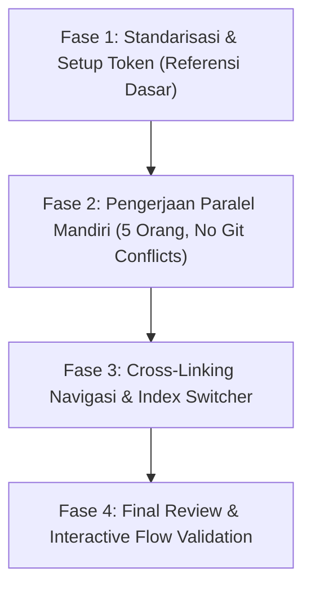

# Task Breakdown & Context Sharing: FleetTrack Nexa v2 Prototype
**Target Project:** `polosan-nexa-v2` (HTML, Tailwind CSS, Lucide Icons)  
**Referensi Utama:** [Konsep v2 - Monitoring Mobil Dinas & Safety](../../Obsidian%20Vault/FleetTrack/07%20-%20Roadmap%20&%20Planning/Konsep%20v2%20-%20Monitoring%20Mobil%20Dinas%20&%20Safety.md)  
**Tujuan:** Mengubah prototipe dashboard dari fokus audit BBM / finansial lama menjadi **Monitoring Mobil Dinas & Safety Kesiapan Operasional 4-Level**.

---

## 1. Aturan Dasar & Standar UI (Wajib Dipatuhi Semua Anggota)

### A. Model Status Kesiapan 4-Level (Bukan Biner "Sehat/Sakit")
Jangan gunakan kata *"Sehat / Tidak Sehat"* atau *"Driver Lelah"*. Gunakan status kesiapan operasional:

| Entitas | Status (Level) | Badge UI Tailwind | Keterangan & Aksi |
|---|---|---|---|
| **Kendaraan** | `SIAP JALAN` | `bg-emerald-50 text-emerald-700 border-emerald-200` | Semua dimensi aman, boleh ditugaskan |
| | `SIAP DENGAN CATATAN` | `bg-amber-50 text-amber-700 border-amber-200` | Ada temuan minor, boleh jalan + tindak lanjut |
| | `TIDAK SIAP JALAN` | `bg-rose-50 text-rose-700 border-rose-200` | Ada hard fail, **diblokir dari penugasan** |
| | `BELUM DINILAI` | `bg-slate-100 text-slate-600 border-slate-200` | Data belum ada / checklist kedaluwarsa |
| **Driver** | `SIAP BERTUGAS` | `bg-emerald-50 text-emerald-700 border-emerald-200` | Lolos deklarasi fit & HOS aman |
| | `SIAP DENGAN PEMANTAUAN` | `bg-amber-50 text-amber-700 border-amber-200` | Ada catatan ringan / HOS mendekati kuota |
| | `TIDAK SIAP BERTUGAS` | `bg-rose-50 text-rose-700 border-rose-200` | Tidak fit / SIM expired / melebihi HOS (Blokir) |
| | `BELUM DEKLARASI` | `bg-slate-100 text-slate-600 border-slate-200` | Belum submit deklarasi fit-to-drive hari ini |

### B. Aturan "Hard Fail"
* Item kritis inspeksi gagal (rem, ban, lampu utama, kemudi, APAR, pintu darurat bus) **langsung memblokir kendaraan** (`TIDAK SIAP JALAN`), tidak boleh ditoleransi oleh skor rata-rata.
* Dokumen kedaluwarsa (KIR/STNK) atau servis terlambat juga otomatis hard fail.

### C. Konsistensi Desain Prototipe
* Gunakan Tailwind CDN, Google Fonts (`Plus Jakarta Sans` & `JetBrains Mono`), dan `Lucide Icons`.
* Latar belakang halaman: `bg-[#f5f7fb]`. Card: `bg-white border border-[#e4e8f0] rounded-[10px]`.
* Sidebar: `bg-[#222845]` dengan logo Nexa FleetTrack.
* Script Lucide wajib diinisialisasi di akhir body: ``.

---

## 2. Fase Pengerjaan (Roadmap)

* **Fase 1 (Design Standards):** Semua orang memahami tabel status kesiapan dan komponen badge di atas.
* **Fase 2 (Eksekusi Paralel):** Masing-masing mengerjakan file miliknya secara independen sesuai pembagian tugas.
* **Fase 3 (Integrasi Navigasi):** Update link sidebar antar halaman dan update kartu portal `index.html`.
* **Fase 4 (Validasi):** Pengecekan konsistensi skenario demo mobil dinas (cek alur hard fail, dokumen expired, approval).

---

## 3. Matriks Pembagian Tugas 5 Orang

| PIC | Peran / Domain | File Utama yang Dikerjakan | Fokus Pekerjaan |
|---|---|---|---|
| **Mica** | **Executive Overview** | `executive.html` | Dashboard Eksekutif 5 Blok Kesiapan Armada & Driver |
| **Timothy** | **Manager Control** | `manager.html` `manager-usage.html` *(baru)* | Persetujuan Pemakaian Unit, Verifikasi Servis, Live Map HOS |
| **Dito** | **Auditor Workspace** | `auditor.html` `auditor-inspection.html` *(baru)* | Workspace Uji Petik Inspeksi, Manajemen Kasus & Aturan Risiko |
| **Fairus** | **Admin Armada & Dokumen** | `admin.html` `admin-fleet.html` `admin-work-units.html` *(baru)* | Master Unit Kerja/Pool, Dokumen KIR/STNK, Master Armada |
| **Afan** | **Admin Servis & Safety Flow** | `admin-driver.html` `admin-maintenance.html` *(baru)* `admin-templates.html` *(baru)* `driver-mobile.html` *(baru)* | Template Checklist (Hard Fail), Input Servis, Simulasi Mobile Driver |

---

## 4. Rincian Konteks & Panduan Teknis per Orang

---

### 👤 MICA — Executive Overview & Strategic Dashboard
* **File Target:** `executive.html`
* **Konteks Bisnis:** Eksekutif tidak butuh laporan keuangan/MRR di layar ini. Yang dibutuhkan adalah jawaban langsung: *"Berapa armada & driver yang siap beroperasi hari ini, dan unit mana yang diblokir beserta alasannya?"* (Tanpa membuka data privasi pribadi driver).

#### Checklist Pekerjaan Mica:
1. **Rombak Header & KPI Card Finansial:**
   * Hapus card lama ("Pendapatan", "MRR", "Churn Rate").
2. **Implementasi Blok A — Kesiapan Armada Hari Ini:**
   * 4 Kartu Status: `SIAP JALAN`, `SIAP DENGAN CATATAN`, `TIDAK SIAP JALAN`, `BELUM DINILAI`.
   * Dua Rasio Utama:
     * **Kesiapan Operasional:** `(Siap + Catatan) / Total Aktif` (misal 92%).
     * **Kesiapan Penuh:** `Siap / Total Aktif` (misal 78%).
   * List interaktif: Kartu/Drawer "3 Kendaraan Diblokir Hari Ini" lengkap dengan badge alasan (contoh: *Bus B 1234 XY - Rem Utama Gagal; Hiace B 5678 CD - KIR Kedaluwarsa*).
3. **Implementasi Blok B — Kesiapan Driver:**
   * 4 Kartu Status: `SIAP BERTUGAS`, `SIAP DENGAN PEMANTAUAN`, `TIDAK SIAP BERTUGAS`, `BELUM DEKLARASI`.
   * Indikator Driver Risiko Tinggi 30 hari (bukan "lelah", tapi skor risiko perilaku & HOS) dan counter SIM hampir habis (≤60 hari).
4. **Implementasi Blok C — Kepatuhan & Risiko:**
   * Warning items: Dokumen Kedaluwarsa (Merah), Servis Jatuh Tempo (Kuning), Temuan Kritis Terbuka (Kasus High), Kepatuhan Checklist (% Pra/Pasca Trip).
5. **Implementasi Blok D — Tren 30/90 Hari:**
   * Visualisasi stacked bar 4 warna untuk komposisi status harian.
   * Diagram horizontal: Top 5 Penyebab Blokir Kendaraan (Rem, Ban, Dokumen, Servis, Telemetri).
6. **Implementasi Blok E — Peringkat Unit Kerja:**
   * Tabel komparasi performa pool/unit kerja (Pool Pusat, Pool Regional, Pool Operasional) diurutkan dari kesiapan terendah untuk drill-down.

---

### 👤 TIMOTHY — Manager Operational Control & Approvals
* **File Target:** `manager.html`, buat file baru `manager-usage.html`
* **Konteks Bisnis:** Manager bertindak sebagai **Pengendali (Lini ke-2)**. Manager yang menyetujui pemakaian mobil dinas, memverifikasi servis dari Admin, dan memantau operasional armada secara real-time.

#### Checklist Pekerjaan Timothy:
1. **Bersihkan Menu & Card BBM di `manager.html`:**
   * Hapus/arsipkan menu navigasi: *Fuel Receipt Approval*, *Fuel Limit Approval*, dan *Refueling Analytics*.
2. **Perbarui Dashboard Operasional (`manager.html`):**
   * KPI Card: Pengajuan Dinas Menunggu Persetujuan, Perawatan Menunggu Verifikasi, Unit Dalam Tugas, Driver Dekat Batas HOS.
   * Live Map & Telemetri Card: Peta rute kendaraan dinas aktif dengan badge indikator HOS (misal: *Budi - 3.5 jam non-stop / Aman*, *Joko - 4.2 jam / Peringatan Istirahat*).
   * Panel Temuan Lapangan & Tindak Lanjut: Tombol aksi langsung (*Kirim ke Bengkel*, *Ganti Unit Pengganti*, *Tangguhkan Kendaraan*).
3. **Buat Halaman Persetujuan Pemakaian Kendaraan (`manager-usage.html`):**
   * Menggantikan alur lama `fleet-operation`.
   * Tabel daftar permohonan mobil dinas (Pemohon, Unit Kerja, Keperluan Dinas, Mobil, Driver, Jam Berangkat - Selesai, Status).
   * Validasi Interaktif: Jika mobil berstatus `TIDAK SIAP JALAN`, tombol *Approve* dinonaktifkan dengan tooltip/badge peringatan *"Kendaraan diblokir oleh sistem safety"*.
4. **Widget Verifikasi Servis Perawatan:**
   * List inspeksi perawatan yang baru diinput Admin: Tampilkan foto nota & foto pengerjaan fisik bengkel, dengan tombol *Approve Verifikasi* atau *Minta Revisi*.

---

### 👤 DITO — Auditor Workspace & Quality Assurance
* **File Target:** `auditor.html`, buat file baru `auditor-inspection.html`
* **Konteks Bisnis:** Auditor adalah **Pengawas Independen (Lini ke-3)**. Auditor tidak boleh menginput data operasional harian. Tugasnya menguji petik keaslian data lapangan dan menangani kasus insiden/temuan kritis.

#### Checklist Pekerjaan Dito:
1. **Pembaruan KPI & Workspace (`auditor.html`):**
   * KPI Card: Temuan Kritis Terbuka (High Severity), Uji Petik Menunggu Review, Anomali Telemetri Aktif, Indeks Integritas Inspeksi.
   * Tabel Temuan & Kasus (`cases`): Kolom No. Kasus, Unit/Driver Terkait, Severity (`CRITICAL`, `HIGH`, `MEDIUM`), Temuan (contoh: *Indikasi Pemalsuan Foto Odometer*, *Rem Blong Terabaikan*), Status Investigasi.
2. **Buat Halaman Workspace Uji Petik (`auditor-inspection.html`):**
   * Fitur **Cross-Check 4 Dimensi**:
     * Panel 1: Checklist yang diisi driver (jawaban Ya/Tidak + catatan).
     * Panel 2: Bukti Foto yang diupload (foto ban, speedometer, APAR).
     * Panel 3: Lokasi GPS & Timestamp saat checklist di-submit (mencegah checklist fiktif).
     * Panel 4: Telemetri TimescaleDB pada menit yang sama (apakah mesin nyala, voltase aki, suhu).
   * Tombol aksi Auditor: *Tandai Sah*, *Minta Klarifikasi Driver*, *Eskalasi ke Temuan Kritis (Buka Kasus)*.
3. **Panel Parameter Aturan Risiko (`auditor.html`):**
   * Form pengaturan ambang batas anomali (Threshold Suhu Mesin > 105°C, Batas HOS Maks 4 Jam, Hard Braking limit).

---

### 👤 FAIRUS — Admin Master Armada, Unit Kerja & Dokumen Legal
* **File Target:** `admin.html`, `admin-fleet.html`, buat file baru `admin-work-units.html`
* **Konteks Bisnis:** Admin bertindak sebagai **Pelaksana (Lini ke-1)**. Bertanggung jawab atas integritas master data armada mobil dinas, unit kerja (pool), dan kepatuhan dokumen legal (KIR, STNK, Pajak, Asuransi).

#### Checklist Pekerjaan Fairus:
1. **Pembaruan Admin Overview (`admin.html`):**
   * KPI Card: Total Mobil Dinas, Dokumen Kedaluwarsa / Hampir Habis, Unit Kerja Aktif, Total Pengguna.
   * Role Distribution & Activity Log disesuaikan dengan aktivitas operasional dinas.
2. **Pembaruan Master Armada (`admin-fleet.html`):**
   * Filter tabel berdasarkan Tipe Kendaraan (Bus, Hiace, Mobil Dinas Penumpang) dan Unit Kerja / Pool.
   * Ganti kolom status konvensional dengan **Badge Status Kesiapan 4-Level** (`SIAP JALAN`, `SIAP DENGAN CATATAN`, `TIDAK SIAP JALAN`, `BELUM DINILAI`).
   * Detail modal kendaraan: Tab khusus informasi Odometer, Unit Kerja penanggung jawab, dan riwayat status kesiapan.
3. **Buat Halaman Master Unit Kerja (`admin-work-units.html`):**
   * Struktur pool mobil dinas (contoh: *Pool Kantor Pusat*, *Pool Operasional Regional 1*, *Pool Transportasi VIP*).
   * Tabel daftar unit kerja: Nama Pool, Kode, Penanggung Jawab, Jumlah Unit Armada, Jumlah Driver. Modal Tambah/Edit Unit Kerja.
4. **Integrasi Manajemen Dokumen Kendaraan:**
   * Di dalam detail armada atau sub-view dokumen: Tabel masa berlaku KIR, STNK, Pajak Tahunan, dan Asuransi.
   * Indikator warna jatuh tempo: Hijau (>60 hari), Kuning HAMPIR KEDALUWARSA (≤60 hari), Merah KEDALUWARSA.
   * Form upload lampiran bukti dokumen (PDF / JPG).

---

### 👤 AFAN — Admin Servis, Template Checklist & Driver Safety Flow
* **File Target:** `admin-driver.html`, buat file baru `admin-maintenance.html`, `admin-templates.html`, dan `driver-mobile.html`
* **Konteks Bisnis:** Menangani pencatatan perawatan fisik, konfigurasi checklist keselamatan berfitur *Hard-Fail*, serta merancang simulasi mobile view untuk driver lapangan.

#### Checklist Pekerjaan Afan:
1. **Pembaruan Master Driver (`admin-driver.html`):**
   * Tambah kolom/badge Masa Berlaku SIM (alert jika ≤60 hari) dan status Surat Keterangan Sehat/MCU.
   * Hapus atribut lama yang berbau saldo/limit bensin.
2. **Buat Halaman Template Checklist (`admin-templates.html`):**
   * Setting formulir checklist harian berdasarkan tipe kendaraan (Bus, Hiace, Mobil Biasa).
   * Fitur saklar/toggle krusial: **`is_critical` (Item Kritis / Hard Fail)**.
   * Kelompok item checklist:
     * Kendali (Rem utama, rem parkir, kemudi) -> *Hard Fail*.
     * Roda (Kondisi ban, tekanan, mur roda) -> *Hard Fail*.
     * Visibilitas (Lampu utama, sein, wiper, spion) -> *Hard Fail*.
     * Keselamatan Umum (Sabuk pengaman, APAR, P3K) -> *Hard Fail*.
     * Khusus Bus/Hiace (Pintu darurat, palu pemecah kaca) -> *Hard Fail*.
     * Kondisi Eksterior/Kenyamanan (AC, body baret, lampu kabut) -> *Minor/Non-kritis*.
3. **Buat Halaman Pencatatan Perawatan (`admin-maintenance.html`):**
   * Form input servis oleh Admin: Nama Bengkel, Tanggal Servis, Odometer saat servis, Biaya, Estimasi Servis Berikutnya (km/tanggal).
   * **Wajib Upload Bukti:** Area upload foto nota bengkel & foto pengerjaan fisik.
   * Status record: *Tercatat (Menunggu Verifikasi Manager)*. Admin tidak punya tombol untuk approve inputnya sendiri!
4. **Buat Prototipe Simulasi Driver Mobile (`driver-mobile.html`):**
   * Desain tampilan berbingkai mobile (smartphone frame centered).
   * Layar 1: **Deklarasi Fit-to-Drive** (Input jam tidur semalam, kondisi badan, ceklis persetujuan data pribadi).
   * Layar 2: **Checklist Pra-Trip** dengan tombol kamera foto fisik & odometer.
   * Skenario Interaktif: Jika driver mencentang "Rem Blong" pada item kritis, layar langsung berubah merah bertuliskan: **"KENDARAAN TIDAK SIAP JALAN - TUGAS DIBLOKIR. Silakan lapor ke Manager."**

---

## 5. Sinkronisasi Antar Halaman & Navigasi (Fase 3 & 4)

Setelah pengerjaan paralel selesai:
1. **Sidebar Menu:**
   * Pastikan semua link sidebar saling terhubung dengan benar antar file HTML.
2. **Portal Switcher (`index.html`):**
   * Perbarui kartu portal di `index.html` dengan deskripsi baru sesuai Konsep v2 (Executive, Manager, Auditor, Admin, Driver Flow).
3. **Pengujian Skenario Utama (Golden Path):**
   * *Admin (Afan)* buat item kritis -> *Driver (Afan)* gagal checklist -> *Manager (Timothy)* menerima notifikasi blokir -> *Executive (Mica)* melihat 1 unit masuk list "Tidak Siap Jalan" -> *Auditor (Dito)* melakukan uji petik bukti foto checklist.

---
*Dokumen ini dibuat otomatis sebagai panduan kerja tim FleetTrack Nexa v2.*
